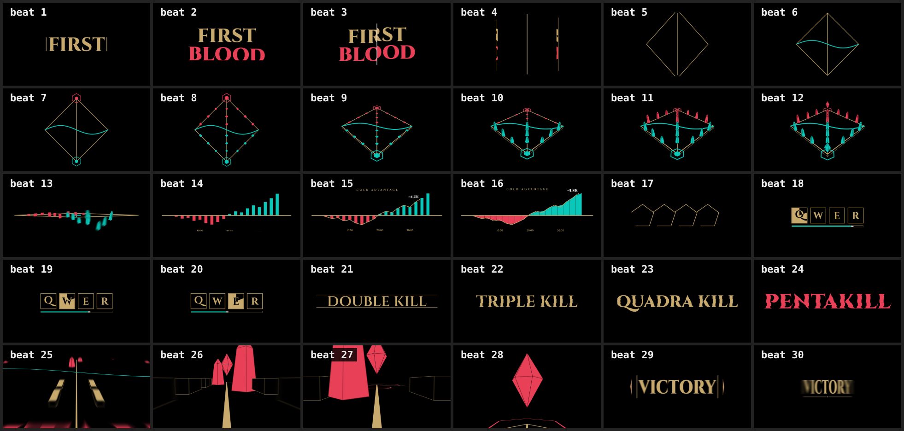

# LINEA → CORSIA → LEGGENDA

Showreel di motion design di 15 secondi a tema **League of Legends**.

> Una sola linea d'oro si apre e diventa un'intera partita, poi si richiude in se stessa.

**Video finale:** [`out/lol-showreel.mp4`](out/lol-showreel.mp4) — 1920×1080, 60 fps, H.264 + AAC, 15,0 s, in loop.



## Regole

| | |
|---|---|
| Tempo | 120 BPM: beat = 0,5 s, battuta = 2 s. In totale 7 battute + ½, con un evento su ogni beat |
| Font | **Cinzel**, variabile 400–900 (Google Fonts, OFL). I contorni sono estratti in `tools/glyphs.json`, così il testo è geometria che si può tagliare, piegare e proiettare in 3D |
| Palette | oro hextech `#C8AA6E`, blu `#0AC8B9`, rosso `#E84057`, nero, bianco |
| Camera | sempre sull'asse verticale centrale (= la mid lane). Avanza (push) e si inclina sulla cerniera orizzontale: niente pan, roll o shake |
| Transizioni | nessun taglio e nessun crossfade: ogni scena è fatta con forme, testo e colori della precedente |
| Easing | esponenziale e molle smorzate (ζ ≥ 0,72), tutto calcolato in funzione del tempo |
| Motion blur | ogni elemento ha un blur gaussiano orientato lungo la sua velocità, più 3 sottoframe fusi con `tmix` |

## Storyboard beat per beat

| Battuta | Beat | t (s) | Cosa succede |
|---|---|---|---|
| **1 · HOOK** | 1 | 0,0 | La linea d'oro (frame 0) si sdoppia e **FIRST** si apre a fisarmonica dal centro |
| | 2 | 0,5 | **BLOOD** (rosso) sale dalla propria linea di base, FIRST si alza con una molla |
| | 3 | 1,0 | Una lama bianca taglia le parole in verticale e le due metà slittano |
| | 4 | 1,5 | Due linee d'oro calano sui bordi e le metà ci scivolano dentro: il Rift si apre |
| **2 · SHAPE MORPH** | 5 | 2,0 | Le linee si piegano a `<` `>`: rombo + diagonale = top, mid e bot lane |
| | 6 | 2,5 | Il fiume: una linea blu attraversa il centro e si piega a S |
| | 7 | 3,0 | I vertici si gonfiano in cerchi che diventano esagoni: i Nexus |
| | 8 | 3,5 | 18 torri scattano sulle corsie: la minimappa |
| **3 · 2D → 3D** | 9 | 4,0 | La cerniera si inclina: la minimappa diventa un pavimento con spessore |
| | 10 | 4,5 | Si estrudono le torri blu (obelischi) |
| | 11 | 5,0 | Si estrudono le torri rosse |
| | 12 | 5,5 | Gli esagoni salgono e diventano cristalli 3D che ruotano |
| **4 · DATA** | 13 | 6,0 | La mappa si schiaccia in un asse e le torri sfilano in colonne (le rosse sotto lo zero) |
| | 14 | 6,5 | Camera frontale: il pavimento diventa la linea dello zero, compaiono i minuti |
| | 15 | 7,0 | La linea **GOLD ADVANTAGE** si disegna sulle cime, con un contatore sulla punta |
| | 16 | 7,5 | Le colonne si fondono in un grafico ad area: **+5.8K** |
| **5 · UI** | 17 | 8,0 | Il grafico si appiattisce e l'asse si piega in 4 quadrati: **Q W E R** |
| | 18–20 | 8,5–9,5 | Q, W, E: riempimento oro, sweep di cooldown, la barra mana scende |
| **6 · KINETIC TYPE + riser** | 21 | 10,0 | **R**: l'HUD collassa in una lama che si apre come una mascella su **DOUBLE KILL** |
| | 22 | 10,5 | **TRIPLE KILL**: 3 fette scambiano la parola |
| | 23 | 11,0 | **QUADRA KILL**: 4 fette |
| | 24 | 11,5 | **PENTAKILL**: 5 fette, rosso, a tutta larghezza |
| **7 · CLIMAX** | 25 | 12,0 | Drop: PENTAKILL si sdraia sul pavimento e la camera carica lungo la mid tra i muri |
| | 26–27 | 12,5–13,0 | Le torrette rosse (in slalom) lampeggiano e crollano al passaggio |
| | 28 | 13,5 | Crolla l'ultima torretta e il Nexus riempie lo schermo |
| **½ · END TITLE** | 29 | 14,0 | La lama dell'inizio taglia il Nexus: le metà diventano parentesi e si apre **VICTORY** |
| | 30 | 14,5 | Un ornamento si disegna sotto, poi tutto si richiude nella linea del frame 0 |

L'ultimo frame coincide con il primo, quindi il video gira in loop senza giunture.

## Colonna sonora

È scritta in codice con la Web Audio API (`OfflineAudioContext`) dentro `showreel.html` ed esportata in WAV:

- 120 BPM in Re minore: Dm, B♭, F, C, Dm, B♭→A, B♭, C, poi re maggiore su VICTORY;
- kick su ogni beat e hit su ogni cambio scena (0, 2, 4 … 14 s);
- riser (rumore filtrato + saw + rullata) da 10 a 12 s, dentro l'ultima battuta piena;
- effetti sincronizzati con l'immagine: lama, whoosh, cast di Q/W/E/R, crolli delle torrette;
- la coda oltre i 15 s viene sommata all'inizio, così anche l'audio gira in loop. Integrato ≈ −16 LUFS.

## Struttura

```
src/showreel.html     sorgente: tutta l'animazione è window.seek(t), più window.renderAudio()
showreel.html         file unico autosufficiente (glifi inclusi): node tools/build.mjs
tools/make-glyphs.mjs estrae i contorni di Cinzel per peso (fontkit) → tools/glyphs.json
tools/render.mjs      render con Playwright: stills | strip | beats | audio | frames | encode
fonts/                Cinzel variabile + licenza OFL
out/lol-showreel.mp4  il video
```

## Rigenerare

```bash
cd tools && npm install            # fontkit
node make-glyphs.mjs               # solo se cambiano le stringhe di testo
node build.mjs                     # src → showreel.html
node render.mjs beats              # un frame per beat + contact sheet (controllo)
node render.mjs audio              # out/soundtrack.wav
node render.mjs frames 4           # 2700 sottoframe a 180 fps, 4 worker
node render.mjs encode             # tmix 3 sottoframe → 60 fps, mux audio → out/lol-showreel.mp4
```

Il sottoframe `j` viene renderizzato a `t = (j − 1)/180`: i tre sottoframe fusi per il frame `k` sono centrati su `k/60`. `seek` ripiega `t` modulo 15 s, quindi anche il primo frame riceve il blur corretto dal loop.

*Fan art non ufficiale. League of Legends è un marchio di Riot Games.*
